# Data Visualization with Python: A Comprehensive Guide to Matplotlib and Seaborn

---

## 1. Introduction to Data Visualization

Data visualization is the graphical representation of information and data. By translating raw numerical records and dimensions into visual formats such as charts, graphs, and maps, visualization enables analysts and stakeholders to:
* Quickly identify underlying trends, outliers, and patterns.
* Comprehend large volumes of data at a glance.
* Formulate data-driven hypotheses and research questions.
* Communicate analytical findings persuasively to non-technical stakeholders.

In the Python data science ecosystem, **Matplotlib** and **Seaborn** form the primary foundation for static, statistical, and publication-ready charting. This guide provides a thorough overview of both libraries, detailing their architecture, standard chart implementations, practical use cases, and an objective comparative analysis.

---

## 2. Matplotlib Deep Dive

### 2.1 Overview and Architecture
Created by John D. Hunter in 2002, Matplotlib is a low-level, desktop-grade 2D plotting library designed to offer MATLAB-like plotting power to Python programmers. 

Matplotlib's core design revolves around an explicit object-oriented hierarchy:
1. **Figure (plt.Figure)**: The top-level bounding window or page that holds all visual artists, canvas elements, titles, subplots, and colorbars.
2. **Axes (plt.Axes)**: The actual bounding box/coordinate space where data is plotted. A single Figure can contain multiple Axes objects (subplots).
3. **Axis (matplotlib.axis.Axis)**: Responsible for establishing data limits, ticks, tick locators, and axis labels for the x and y dimensions.
4. **Artists**: Every visual element rendered on the canvas (lines, text, patches, shapes, markers) is an Artist instance.
5. **Pyplot (matplotlib.pyplot)**: A convenient procedural state-machine interface that exposes functions to create and manipulate figures and axes.

---

### 2.2 Line Plot
* **Description**: Connects sequential discrete data points using continuous straight-line segments.
* **Best Use Cases**: Visualizing continuous trends across time (time-series analysis), tracking financial metrics (revenue, expenses, stock prices), and measuring experimental signals.

`python
import matplotlib.pyplot as plt

months = ['Jan', 'Feb', 'Mar', 'Apr', 'May', 'Jun', 'Jul', 'Aug', 'Sep', 'Oct', 'Nov', 'Dec']
revenue = [45, 52, 48, 58, 63, 70, 68, 75, 82, 88, 95, 102]
expenses = [30, 32, 35, 34, 38, 42, 40, 44, 46, 50, 52, 55]

fig, ax = plt.subplots(figsize=(10, 5), dpi=300)
ax.plot(months, revenue, marker='o', linewidth=2.2, color='#2b5c8f', label='Revenue ()')
ax.plot(months, expenses, marker='s', linewidth=2, linestyle='--', color='#d95f02', label='Expenses ()')

ax.set_title('Monthly Financial Performance (2023)', fontsize=14, fontweight='bold', pad=12)
ax.set_xlabel('Month', fontsize=11)
ax.set_ylabel('Amount (in Thousands USD)', fontsize=11)
ax.legend(frameon=True, facecolor='white', framealpha=0.9)
ax.grid(True, linestyle=':', alpha=0.6)

plt.tight_layout()
plt.savefig('plots/matplotlib_line_plot.png')
plt.show()
`

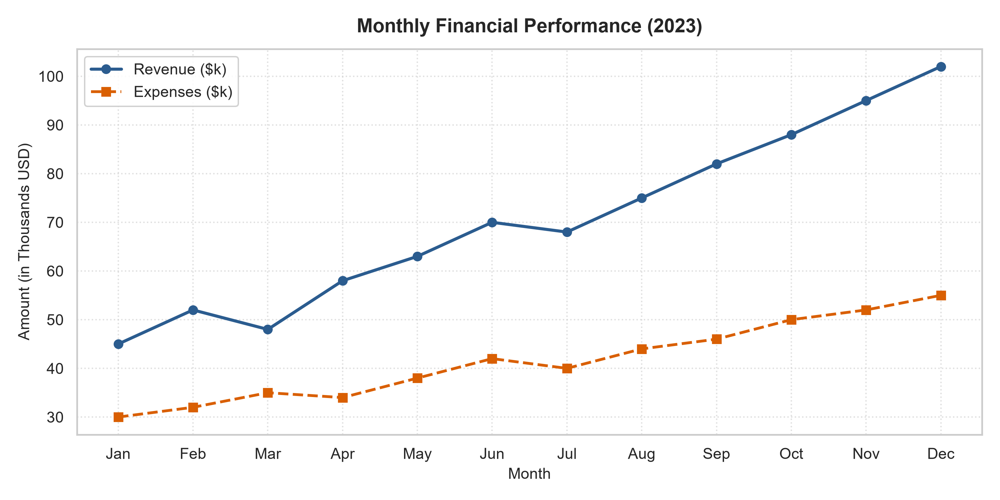

---

### 2.3 Grouped Bar Chart
* **Description**: Represents categorical variables using rectangular bars where bar heights correspond proportionally to metric values.
* **Best Use Cases**: Comparing discrete groups across multiple conditions, evaluating cross-category sales metrics, and quarterly performance benchmarking.

`python
import numpy as np
import matplotlib.pyplot as plt

categories = ['Electronics', 'Clothing', 'Home & Kitchen', 'Books', 'Sports']
sales_2022 = [120, 85, 95, 45, 60]
sales_2023 = [145, 92, 110, 48, 78]

x = np.arange(len(categories))
width = 0.35

fig, ax = plt.subplots(figsize=(10, 5), dpi=300)
rects1 = ax.bar(x - width/2, sales_2022, width, label='2022 Sales', color='#4575b4')
rects2 = ax.bar(x + width/2, sales_2023, width, label='2023 Sales', color='#74add1')

ax.set_title('Annual Product Category Sales Comparison', fontsize=14, fontweight='bold', pad=12)
ax.set_xlabel('Product Category', fontsize=11)
ax.set_ylabel('Sales Units (k)', fontsize=11)
ax.set_xticks(x)
ax.set_xticklabels(categories)
ax.legend(frameon=True)
ax.bar_label(rects1, padding=3, fontsize=9)
ax.bar_label(rects2, padding=3, fontsize=9)
ax.grid(axis='y', linestyle=':', alpha=0.6)

plt.tight_layout()
plt.savefig('plots/matplotlib_bar_chart.png')
plt.show()
`

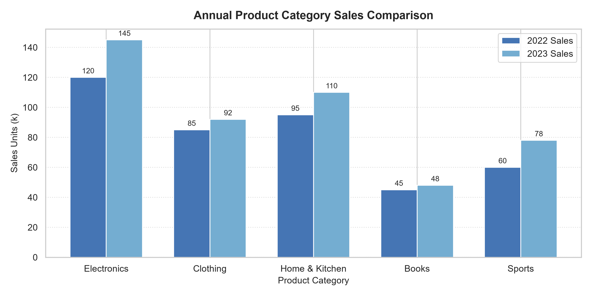

---

### 2.4 Scatter Plot with Continuous Color and Sizing
* **Description**: Plots Cartesian coordinates for two continuous variables. Supplementary variables can be mapped directly onto marker color gradients and marker dimensions.
* **Best Use Cases**: Bivariate correlation analysis, identifying clusters, detecting multivariate outliers, and evaluating Return on Investment (ROI) vs. advertising spend.

`python
import numpy as np
import matplotlib.pyplot as plt

np.random.seed(42)
ad_spend = np.random.uniform(5, 50, 60)
sales = 12 + 1.8 * ad_spend + np.random.normal(0, 8, 60)
roi = sales / ad_spend

fig, ax = plt.subplots(figsize=(9, 5.5), dpi=300)
scatter = ax.scatter(ad_spend, sales, c=roi, cmap='viridis', s=roi*35, alpha=0.8, edgecolors='black', linewidth=0.5)
cbar = plt.colorbar(scatter)
cbar.set_label('ROI Factor', fontsize=10)

ax.set_title('Marketing Spend vs. Sales Revenue', fontsize=14, fontweight='bold', pad=12)
ax.set_xlabel('Ad Spend ()', fontsize=11)
ax.set_ylabel('Sales Revenue ()', fontsize=11)
ax.grid(True, linestyle=':', alpha=0.6)

plt.tight_layout()
plt.savefig('plots/matplotlib_scatter_plot.png')
plt.show()
`

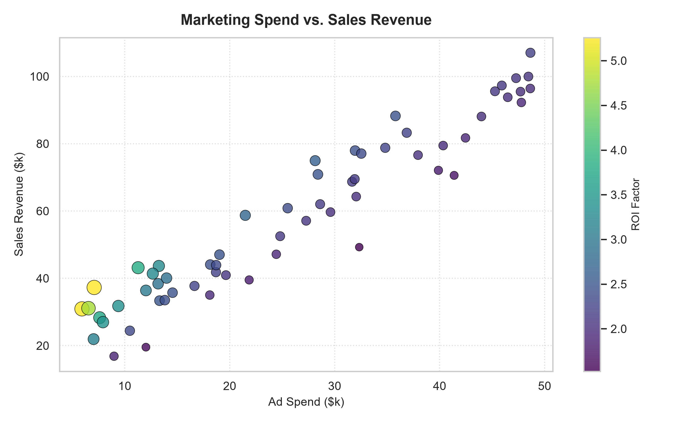

---

### 2.5 Histogram with Distribution Thresholds
* **Description**: Partitions a continuous numeric range into contiguous bins and counts observation frequencies per bin.
* **Best Use Cases**: Assessing normality, evaluating population age demographics, diagnosing skewness, and detecting multi-modal distribution profiles.

`python
import numpy as np
import matplotlib.pyplot as plt

np.random.seed(101)
customer_ages = np.random.normal(36, 11, 500)

fig, ax = plt.subplots(figsize=(9, 5), dpi=300)
n, bins, patches = ax.hist(customer_ages, bins=25, color='#3182bd', edgecolor='white', alpha=0.85)
ax.axvline(np.mean(customer_ages), color='#de2d26', linestyle='dashed', linewidth=2, label=f'Mean Age: {np.mean(customer_ages):.1f}')

ax.set_title('Customer Age Distribution', fontsize=14, fontweight='bold', pad=12)
ax.set_xlabel('Age (Years)', fontsize=11)
ax.set_ylabel('Number of Customers', fontsize=11)
ax.legend()
ax.grid(axis='y', linestyle=':', alpha=0.6)

plt.tight_layout()
plt.savefig('plots/matplotlib_histogram.png')
plt.show()
`

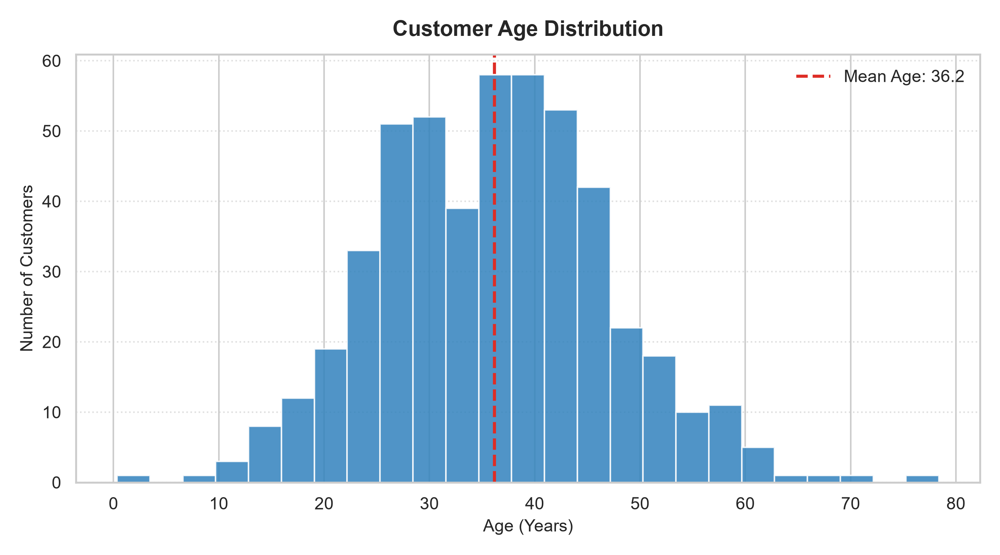

---

### 2.6 Pie Chart
* **Description**: A circular statistical graphic divided into slices illustrating numerical proportion.
* **Best Use Cases**: Displaying high-level composition and market share when the total number of distinct categories is strictly limited (5 or fewer).

`python
import matplotlib.pyplot as plt

market_segments = ['Cloud Services', 'Hardware', 'Software & SaaS', 'Consulting', 'Cybersecurity']
market_share = [34, 26, 20, 12, 8]
colors = ['#1f77b4', '#aec7e8', '#ff7f0e', '#ffbb78', '#2ca02c']
explode = (0.06, 0, 0, 0, 0)

fig, ax = plt.subplots(figsize=(7, 7), dpi=300)
wedges, texts, autotexts = ax.pie(
    market_share, explode=explode, labels=market_segments, colors=colors,
    autopct='%1.1f%%', startangle=140, pctdistance=0.75,
    textprops=dict(color='black', fontsize=10),
    wedgeprops=dict(edgecolor='white', linewidth=1.5)
)
for autotext in autotexts:
    autotext.set_fontsize(10)
    autotext.set_weight('bold')

ax.set_title('Enterprise Tech Market Share Breakdown', fontsize=14, fontweight='bold', pad=15)
plt.tight_layout()
plt.savefig('plots/matplotlib_pie_chart.png')
plt.show()
`

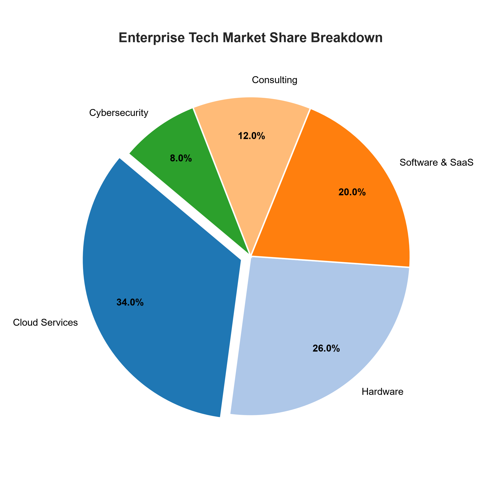

---

### 2.7 Multi-Panel Composite Figures (Subplots)
* **Description**: Assembles multiple coordinated axes within a single canvas using plt.subplots(nrows, ncols).
* **Best Use Cases**: Executive dashboards, composite research reports, and multi-metric health monitoring.

`python
import numpy as np
import matplotlib.pyplot as plt

fig, axs = plt.subplots(2, 2, figsize=(11, 8), dpi=300)
x_vals = np.linspace(0, 10, 100)

axs[0, 0].plot(x_vals, np.sin(x_vals), color='#1b9e77', linewidth=2)
axs[0, 0].set_title('Trigonometric Signal (Sine)', fontsize=11, fontweight='bold')
axs[0, 0].grid(True, linestyle=':', alpha=0.6)

axs[0, 1].bar(['A', 'B', 'C', 'D'], [15, 28, 12, 33], color='#d95f02')
axs[0, 1].set_title('Segment Summary', fontsize=11, fontweight='bold')
axs[0, 1].grid(axis='y', linestyle=':', alpha=0.6)

axs[1, 0].scatter(np.random.rand(40), np.random.rand(40), color='#7570b3', alpha=0.7)
axs[1, 0].set_title('Random Metric Dispersion', fontsize=11, fontweight='bold')
axs[1, 0].grid(True, linestyle=':', alpha=0.6)

axs[1, 1].boxplot([np.random.normal(0, std, 50) for std in range(1, 4)], patch_artist=True,
                  boxprops=dict(facecolor='#e7298a', alpha=0.6))
axs[1, 1].set_title('Variance across Groups', fontsize=11, fontweight='bold')
axs[1, 1].grid(axis='y', linestyle=':', alpha=0.6)

plt.suptitle('Multi-panel Analytical Overview (Matplotlib Subplots)', fontsize=14, fontweight='bold')
plt.tight_layout()
plt.savefig('plots/matplotlib_subplots_grid.png')
plt.show()
`

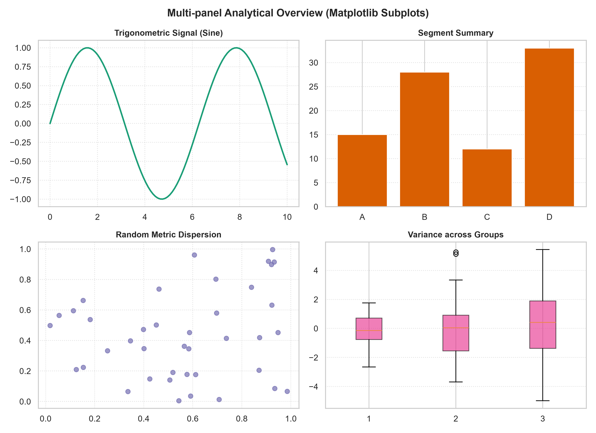

---

## 3. Seaborn Deep Dive

### 3.1 Overview and Architecture
Seaborn is a higher-level statistical data visualization library built directly on top of Matplotlib and integrated closely with Pandas tabular structures.

Core advantages of Seaborn:
* **Direct DataFrame Syntax**: Accepts column names directly as strings, reducing boilerplate indexing.
* **Automatic Statistical Computation**: Aggregates means, standard errors, bootstrapped 95% confidence intervals, and regression fits automatically.
* **Aesthetic Theme Management**: Pre-configured styles (darkgrid, whitegrid, 	icks) and color palettes (muted, deep, iridis, coolwarm).
* **Complex Multi-Plot Exploration**: High-level figure-level functions (catplot, 
elplot, pairplot, displot) simplify multivariate faceted exploration.

The examples below utilize the built-in **	ips** dataset.

---

### 3.2 Multivariate Scatter Plot
* **Description**: Maps bivariate continuous features while encoding categorical and ordinal dimensions via hue, style, and marker size.
* **Best Use Cases**: Examining tipping behavior across lunch vs. dinner hours, customer group sizes, and smoking status.

`python
import seaborn as sns
import matplotlib.pyplot as plt

tips = sns.load_dataset('tips')

plt.figure(figsize=(9, 5.5), dpi=300)
sns.scatterplot(
    data=tips, x='total_bill', y='tip', hue='time',
    size='size', sizes=(30, 200), style='smoker', palette='deep', alpha=0.85
)
plt.title('Relationship between Total Bill and Tip Amount by Meal Time', fontsize=13, fontweight='bold', pad=12)
plt.xlabel('Total Bill ($)', fontsize=11)
plt.ylabel('Tip ($)', fontsize=11)
plt.legend(bbox_to_anchor=(1.02, 1), loc='upper left')

plt.tight_layout()
plt.savefig('plots/seaborn_scatterplot.png')
plt.show()
`

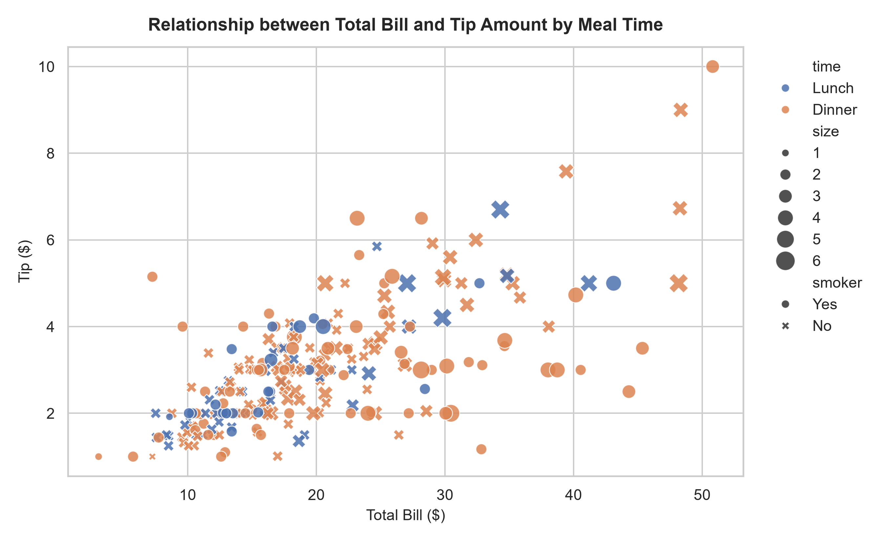

---

### 3.3 Categorical Distributions: Box Plot & Violin Plot
* **Description**: 
  * **Box Plot**: Depicts five-number statistical summaries (minimum, lower quartile, median, upper quartile, maximum) and statistical outliers.
  * **Violin Plot**: Merges a box plot with a rotated Kernel Density Estimation (KDE) plot on each side to visualize multimodal distribution shapes.
* **Best Use Cases**: Evaluating expenditure consistency across weekdays and assessing gender/smoking variance.

`python
import seaborn as sns
import matplotlib.pyplot as plt

tips = sns.load_dataset('tips')

fig, axes = plt.subplots(1, 2, figsize=(14, 5.5), dpi=300)

# Box Plot
sns.boxplot(data=tips, x='day', y='total_bill', hue='sex', palette='Set2', showmeans=True,
            meanprops={'marker':'o','markerfacecolor':'white', 'markeredgecolor':'black'}, ax=axes[0])
axes[0].set_title('Bill Distribution across Days by Gender (Box Plot)', fontsize=12, fontweight='bold')
axes[0].set_xlabel('Day of the Week')
axes[0].set_ylabel('Total Bill ($)')

# Violin Plot
sns.violinplot(data=tips, x='day', y='tip', hue='smoker', split=True, inner='quart', palette='Pastel1', ax=axes[1])
axes[1].set_title('Tip Distribution Density across Days (Violin Plot)', fontsize=12, fontweight='bold')
axes[1].set_xlabel('Day of the Week')
axes[1].set_ylabel('Tip ($)')

plt.suptitle('Seaborn Categorical Analysis (Box Plot vs. Violin Plot)', fontsize=14, fontweight='bold')
plt.tight_layout()
plt.savefig('plots/seaborn_boxplot.png')
plt.show()
`

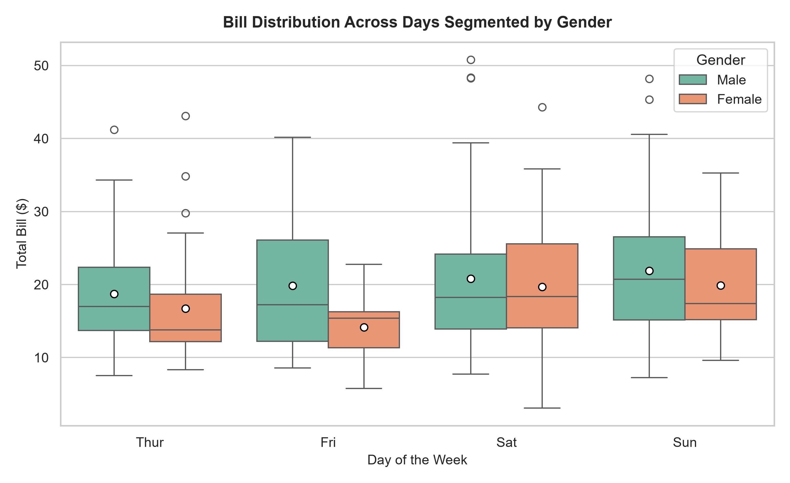
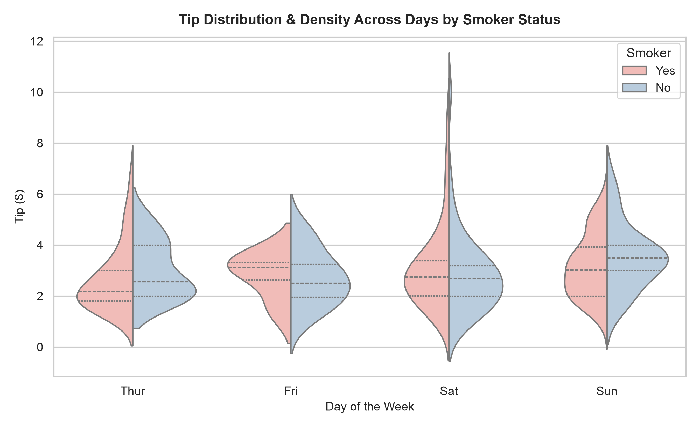

---

### 3.4 Statistical Aggregations: Barplot and Countplot
* **Description**:
  * **Barplot**: Computes point estimates (mean) for each category along with automatic bootstrapped 95% confidence intervals.
  * **Countplot**: Shows observation counts per category (similar to a histogram across discrete categories).
* **Best Use Cases**: Comparing average expenditure across dining days and analyzing customer footfall patterns.

`python
import seaborn as sns
import matplotlib.pyplot as plt

tips = sns.load_dataset('tips')

fig, axes = plt.subplots(1, 2, figsize=(12, 5), dpi=300)

sns.barplot(data=tips, x='day', y='total_bill', hue='time', errorbar=('ci', 95), palette='mako', ax=axes[0])
axes[0].set_title('Average Total Bill by Day (95% CI)', fontsize=12, fontweight='bold')
axes[0].set_xlabel('Day')
axes[0].set_ylabel('Mean Total Bill ($)')

sns.countplot(data=tips, x='day', hue='smoker', palette='rocket', ax=axes[1])
axes[1].set_title('Customer Count by Day & Smoker Group', fontsize=12, fontweight='bold')
axes[1].set_xlabel('Day')
axes[1].set_ylabel('Customer Count')

plt.suptitle('Seaborn Statistical Aggregations', fontsize=14, fontweight='bold')
plt.tight_layout()
plt.savefig('plots/seaborn_bar_count_plot.png')
plt.show()
`

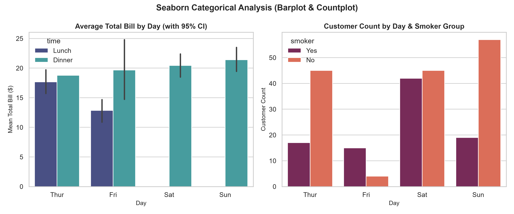

---

### 3.5 Distribution and Kernel Density Estimation (Histplot & KDE)
* **Description**: Plots univariate continuous histograms overlaid with a smooth Kernel Density Estimate curve.
* **Best Use Cases**: Estimating the underlying probability density function of continuous financial metrics like transaction totals.

`python
import seaborn as sns
import matplotlib.pyplot as plt

tips = sns.load_dataset('tips')

plt.figure(figsize=(9, 5), dpi=300)
sns.histplot(data=tips, x='total_bill', hue='time', kde=True, bins=25, palette='viridis', element='step')

plt.title('Total Bill Distribution and Kernel Density Estimation', fontsize=13, fontweight='bold', pad=12)
plt.xlabel('Total Bill ($)', fontsize=11)
plt.ylabel('Frequency', fontsize=11)

plt.tight_layout()
plt.savefig('plots/seaborn_histplot_kde.png')
plt.show()
`

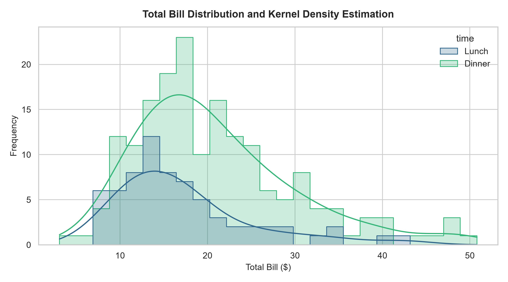

---

### 3.6 Correlation Matrix Heatmap
* **Description**: Visualizes a 2D matrix where individual values are represented by proportional color gradations.
* **Best Use Cases**: Checking multicollinearity between numerical predictors prior to statistical modeling or machine learning.

`python
import numpy as np
import seaborn as sns
import matplotlib.pyplot as plt

tips = sns.load_dataset('tips')
numeric_df = tips.select_dtypes(include=[np.number])
corr = numeric_df.corr()
mask = np.triu(np.ones_like(corr, dtype=bool))

plt.figure(figsize=(8, 6), dpi=300)
sns.heatmap(corr, annot=True, fmt='.3f', cmap='coolwarm', vmin=-1, vmax=1, mask=mask,
            linewidths=1, square=True, cbar_kws={'label': 'Pearson Correlation'})

plt.title('Feature Correlation Matrix (Upper Triangle Masked)', fontsize=13, fontweight='bold', pad=12)
plt.tight_layout()
plt.savefig('plots/seaborn_heatmap.png')
plt.show()
`

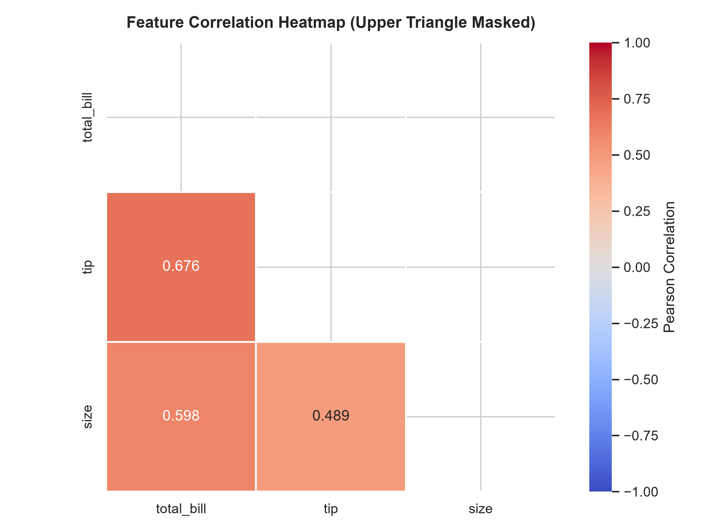

---

### 3.7 Pair Plot (Multivariate Exploration)
* **Description**: Constructs a grid of scatter plots for every pair of continuous variables, with univariate distribution plots placed along the diagonal.
* **Best Use Cases**: Initial exploratory screening of complex datasets to detect cluster separation and inter-variable interactions.

`python
import seaborn as sns
import matplotlib.pyplot as plt

tips = sns.load_dataset('tips')
pair_fig = sns.pairplot(tips[['total_bill', 'tip', 'size', 'sex']], hue='sex', palette='husl', corner=True)
pair_fig.fig.suptitle('Pairwise Multivariate Relationships in Tips Data', y=1.02, fontsize=13, fontweight='bold')

pair_fig.savefig('plots/seaborn_pairplot.png', dpi=300)
plt.show()
`

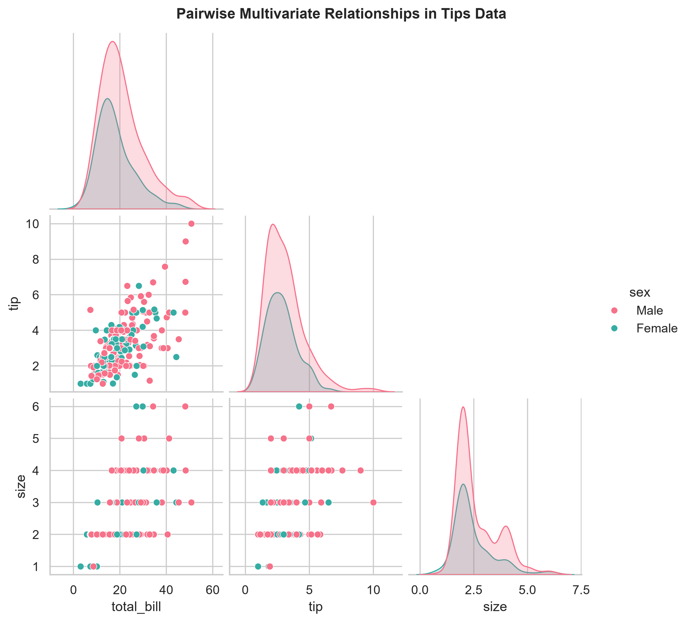

---

## 4. In-Depth Comparative Analysis

### 4.1 Comparison Matrix

| Evaluation Dimension | Matplotlib | Seaborn |
| :--- | :--- | :--- |
| **API Philosophy** | Low-level procedural and object-oriented canvas manipulation. | High-level declarative, semantic, DataFrame-centric approach. |
| **Ease of Use & Syntax** | Detailed and explicit; requires multiple lines for labels, legends, and styling. | Concise; generates complex statistical charts in single-line function calls. |
| **Data Format Support** | Optimized for Python lists, NumPy arrays, and standard dictionaries. | Built natively around tidy Pandas DataFrames. |
| **Statistical Automation** | None built-in; users must compute confidence intervals and aggregations manually. | Automatic computation of confidence intervals, regression lines, and density estimates. |
| **Styling & Aesthetics** | Basic default styling; requires manual adjustments to look modern. | Polished, publication-ready default themes, grids, and balanced color palettes. |
| **Customization Depth** | Unlimited; every pixel, line, spine, and artist can be directly inspected and modified. | Excellent for standard statistical plots; relies on underlying Matplotlib axes for granular styling. |
| **Performance (Large Datasets)** | High speed rendering raw arrays; scalable with collections (LineCollection). | Slight overhead due to internal Pandas transformations and bootstrap computations. |
| **Interactivity** | Basic event loops (Tkinter/Qt); primarily designed for static export. | Primarily static output; relies on external wrappers (Plotly) for dynamic interactivity. |

---

### 4.2 Practical Guidelines: When to Choose Which?

#### Choose Matplotlib when:
1. **Building Custom Visual Architecture**: Developing novel chart types, bespoke layout geometry, or diagrammatic dashboards.
2. **Resource-Constrained or High-Throughput Batch Plotting**: Rendering millions of raw coordinate points directly from NumPy arrays without Pandas overhead.
3. **Fine-Grained Publication Formatting**: Precise control required over tick locations, spines, minor ticks, custom bounding boxes, and embedded inset axes.
4. **Desktop Application Integration**: Embedding interactive canvases directly into GUI applications (PyQt, Tkinter, WxPython).

#### Choose Seaborn when:
1. **Exploratory Data Analysis (EDA)**: Rapidly exploring multidimensional tabular datasets during early-stage investigation.
2. **Statistical Storytelling**: Visualizing distributions, uncertainties, confidence intervals, and regression trends without manual arithmetic.
3. **Multivariate Group Comparisons**: Slicing data across categorical dimensions using hue, col, 
ow, and style.
4. **Professional Reports & Dashboards**: Producing cohesive, aesthetically polished graphics with minimal setup time.

---

### 4.3 Recommended Industry Best Practice: The Hybrid Approach

In professional data science environments, Matplotlib and Seaborn are used synergistically:
1. **Initialize Layout via Matplotlib**: Control figure size, subplots grid, and DPI using ig, ax = plt.subplots(...).
2. **Render Statistics via Seaborn**: Leverage Seaborn to execute high-level statistical plots directed onto the Matplotlib axes: sns.barplot(..., ax=ax).
3. **Fine-Tune Details via Matplotlib**: Apply custom titles, annotations, spines, and layout adjustments using the Matplotlib axes API: x.set_title(...), x.axvline(...), plt.tight_layout().

---

## 5. Summary & Key Takeaways

* **Matplotlib** provides the foundational rendering engine and complete artistic control across all graphical elements.
* **Seaborn** accelerates statistical exploration by providing high-level abstractions that integrate seamlessly with Pandas DataFrames.
* Combining the expressive simplicity of Seaborn with the granular flexibility of Matplotlib yields an effective, robust data visualization workflow.
